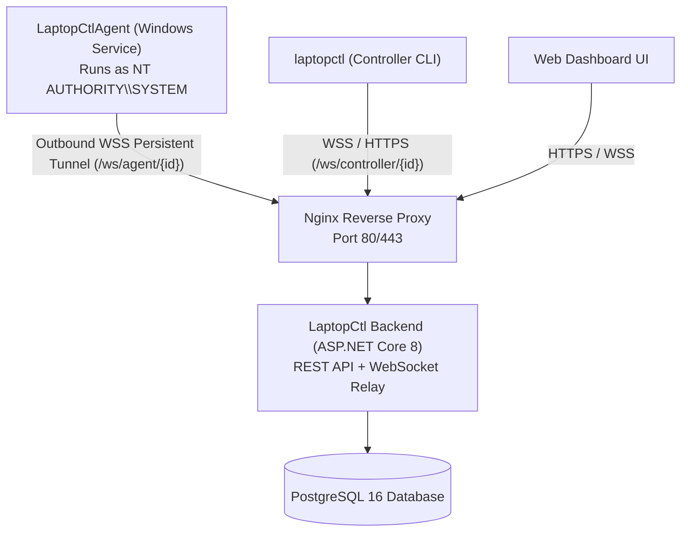

# LaptopCtl

> **Production-Grade Windows Remote Administration Platform**  
> *Inspired by the command-line power of Android Debug Bridge (ADB).*

[]()
[]()
[]()
[](LICENSE)

> ⚠️ **LEGAL NOTICE & ACCEPTABLE USE POLICY**:  
> **LaptopCtl is an IT systems administration and diagnostics platform built exclusively for authorized operators managing machines they own or are explicitly contracted to maintain.**  
> Unauthorized access, covert deployment, surveillance, or misuse against systems without explicit permission is strictly prohibited and illegal under applicable cybercrime legislation (including the CFAA and international equivalents). All operations generate immutable cryptographic audit records.

LaptopCtl allows authorized operators to enroll Windows computers, inspect hardware telemetry, execute approved administrative tasks, transfer authorized files, and initiate remote sessions securely across the internet — **without requiring open inbound firewall ports or VPNs**.

---

## Key Features

- ⚡ **Zero-Config 1-Liner Installation**: Target computers can be enrolled using a single PowerShell command (`irm https://.../install.ps1 | iex`).
- 🔒 **Zero Inbound Attack Surface**: The agent connects outbound over secure WebSockets (`wss://`), traversing NAT, home routers, and enterprise firewalls automatically.
- 🛡️ **Military-Grade Security**: Machine-bound RSA-2048 identity keys encrypted via Windows DPAPI, strict NTFS ACLs (SYSTEM & Administrators only), salted BCrypt token hashing, and strict path traversal protections.
- 💻 **ADB-Inspired CLI (`laptopctl`)**: Rich terminal output with Spectre.Console tables and panels for device listing, hardware diagnostics, process enumeration, disk capacity, and network interfaces.
- 🖥️ **Modern Web Dashboard**: Glassmorphic, dark-themed control panel with real-time telemetry, remote PowerShell terminal, file explorer, and enrollment wizard.
- 📜 **Immutable Audit Trail**: Centralized logging for all administrative operations, sessions, file transfers, and enrollments.
- 🚀 **Production-Ready DevOps**: Docker Compose stack (PostgreSQL 16, ASP.NET Core 8 Backend, Nginx reverse proxy with WebSocket support) and automated GitHub Actions CI/CD.

---

## Architecture Overview



---

## Quick Start

### 1. Build Solution
```bash
dotnet build LaptopCtl.sln
dotnet test LaptopCtl.sln
```

### 2. Generate Enrollment Code
On your operator machine:
```bash
laptopctl login --email admin@example.com
laptopctl enroll-code
```

### 3. Enroll Target Windows Machine
On the target computer, open PowerShell as **Administrator** and run:
```powershell
irm https://api.laptopctl.example.com/install.ps1 | iex; Install-LaptopCtl -EnrollmentCode "<CODE>" -Backend "https://api.laptopctl.example.com"
```

### 4. Administer Enrolled Laptops
```bash
# List all enrolled computers
laptopctl devices

# Query system specs, CPU model, total RAM
laptopctl info <device-id>

# Inspect running processes
laptopctl processes <device-id>

# Check storage capacity
laptopctl disk <device-id>

# Run remote administrative command
laptopctl exec <device-id> "Get-Service LaptopCtlAgent"

# Transfer files
laptopctl files list <device-id> "C:\Users\Public"
laptopctl files upload <device-id> "./update.zip" "C:\Users\Public\update.zip"
```

---

## Documentation

- 📐 [Architecture & Protocol Specification](docs/ARCHITECTURE.md)
- 📖 [CLI Command Reference](docs/CLI_REFERENCE.md)
- 🚀 [Installation & Deployment Guide](docs/INSTALLATION.md)
- 🛡️ [Security Whitepaper & Threat Model](docs/SECURITY.md)

---

## Solution Structure

```text
├── .github/workflows/ci.yml       # Automated CI/CD pipeline
├── dashboard/                     # Modern Web Dashboard (HTML5, Vanilla CSS, JS)
├── deploy/                        # Production Dockerfile, docker-compose.yml, nginx.conf
├── docs/                          # Architecture, CLI Reference, Installation, Security
├── installer/                     # PowerShell install.ps1, uninstall.ps1, publish-all.ps1
├── src/
│   ├── LaptopCtl.Shared/          # Shared DTOs, WebSocket protocol envelopes, models
│   ├── LaptopCtl.Backend/         # ASP.NET Core 8 Web API, SignalR/WebSocket relay, DB
│   ├── LaptopCtl.Agent/           # Windows Service agent, WMI/CIM, DPAPI, file transfer
│   ├── LaptopCtl.Controller/      # Standalone single-file CLI (laptopctl) with Spectre.Console
│   ├── LaptopCtl.Backend.Tests/   # Unit tests with EF Core InMemory database
│   ├── LaptopCtl.Agent.Tests/     # Security tests, path traversal, diagnostics tests
│   └── LaptopCtl.Controller.Tests/# Credentials store, auth, CLI parsing tests
└── LaptopCtl.sln
```
