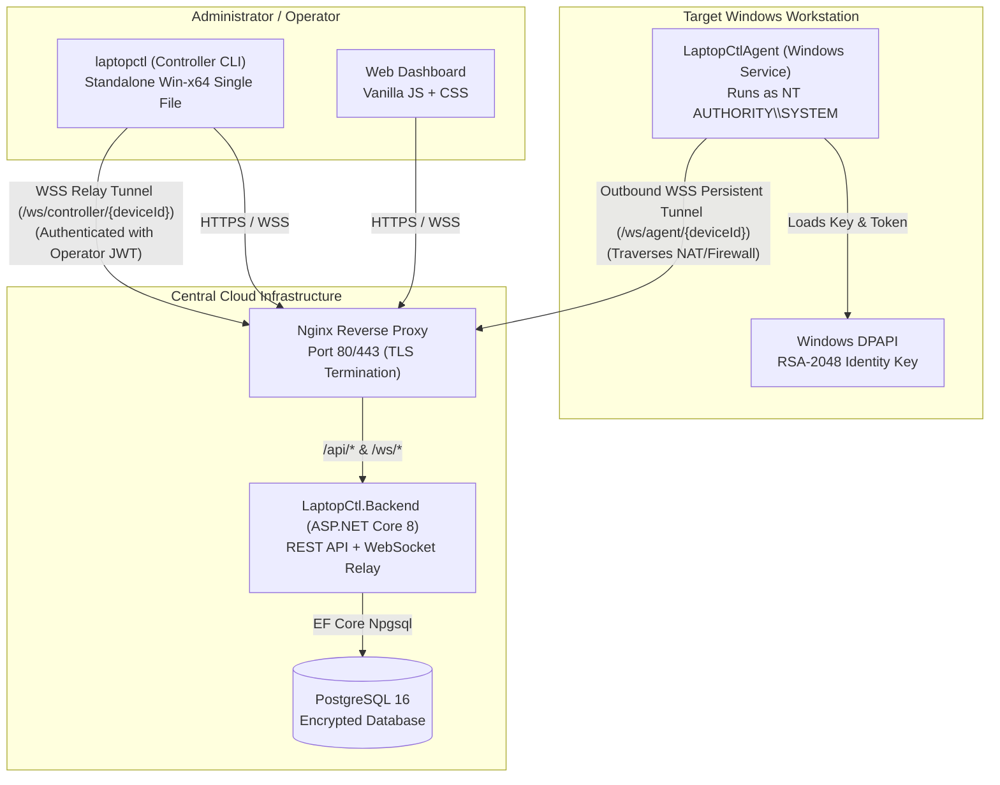

# LaptopCtl Architecture & Protocol Specification

## 1. System Overview

**LaptopCtl** is a high-security, Windows-focused remote administration platform inspired by Android Debug Bridge (ADB). It allows authorized operators to enroll Windows computers, inspect hardware telemetry, execute approved administrative tasks, transfer files, and manage remote sessions over the internet without requiring open inbound firewall ports.



---

## 2. Core Architectural Pillars

### 2.1 Outbound-Only Persistent Reverse Tunnel
Target laptops and workstations frequently operate behind NAT routers, residential ISPs, and corporate firewalls. 
- The **LaptopCtlAgent** never listens on any local TCP or UDP port.
- Upon startup, the agent initiates an outbound TLS connection (`wss://.../ws/agent/{deviceId}`) to the central backend.
- Periodic heartbeats (`agent.ping` / `backend.pong`) keep the TCP socket active through NAT state tables.
- Reconnection logic with exponential backoff and jitter guarantees automatic reconnection after network interruption.

### 2.2 Relay Protocol
When an operator executes a command through the CLI (`laptopctl info <device-id>`) or Dashboard:
1. The controller connects to `wss://.../ws/controller/{deviceId}` presenting a valid JWT bearer token.
2. The `AgentRelayService` validates that the authenticated operator owns the target device.
3. The controller sends a standardized `WsMessage` envelope with a unique `requestId`.
4. The relay forwards the message to the target agent over the agent's pre-established tunnel.
5. The agent executes the operation and returns the result with the matching `requestId`.
6. The relay returns the response to the controller and terminates the relay channel.

---

## 3. Cryptographic Identity & Security Architecture

### 3.1 Device Identity Generation
During enrollment via `install.ps1`:
- The installer creates an RSA-2048 key pair using `[System.Security.Cryptography.RSA]::Create(2048)`.
- The private key is exported in PKCS#8 format and encrypted using the **Windows Data Protection API (DPAPI)** with `DataProtectionScope.LocalMachine`.
- The public key is exported in Base64 DER SubjectPublicKeyInfo format and sent to `/api/enrollment`.

### 3.2 Device Token Hashing (Zero Plaintext Secrets)
- The backend generates a cryptographically secure 64-character random device token using `RandomNumberGenerator`.
- The raw token is returned to the agent **exactly once** during enrollment.
- The backend computes a BCrypt hash (work factor 12) and stores only `DeviceTokenHash` in the PostgreSQL database.
- On agent connection, the token is verified using `BCrypt.Verify(rawToken, device.DeviceTokenHash)`.

### 3.3 Strict NTFS Access Control Lists (ACLs)
The installer configures `$env:ProgramData\LaptopCtl` with strict security descriptors:
- Inheritance is explicitly disabled (`SetAccessRuleProtection($true, $false)`).
- Standard local user permissions are stripped.
- Only `NT AUTHORITY\SYSTEM` and `BUILTIN\Administrators` are granted access.
- Non-administrative user processes cannot read `identity.json` or `device.key`.

### 3.4 Path Traversal Defense
In `FileTransferService`:
- Remote file paths are fully resolved with `Path.GetFullPath()`, eliminating `../` traversal sequences.
- Resolved paths must strictly reside within pre-approved system boundaries (`$env:USERPROFILE`, `$env:PUBLIC`, etc.).
- Attempts to query system directories outside allowed roots immediately trigger `UnauthorizedAccessException`.

---

## 4. WebSocket Message Specification

All real-time communications use the `WsMessage` envelope:

```json
{
  "type": "request.diagnostic",
  "requestId": "a8f94e21-03b6-419b-a012-78d1f2e9603d",
  "issuedAt": "2026-10-26T13:00:00Z",
  "expiresAt": "2026-10-26T13:02:00Z",
  "payload": {
    "diagnosticType": "system.info"
  }
}
```

### Supported Message Types:
| Message Type | Direction | Description |
| :--- | :--- | :--- |
| `agent.hello` | Agent → Backend | Agent announces presence and reported version |
| `agent.ping` | Agent → Backend | Heartbeat ping (every 30 seconds) |
| `backend.pong` | Backend → Agent | Heartbeat reply |
| `request.diagnostic` | Controller → Agent | Request system info, processes, disks, network |
| `diagnostic.result` | Agent → Controller | Diagnostic response payload |
| `request.command` | Controller → Agent | Execute administrative command |
| `command.result` | Agent → Controller | Exit code, stdout, stderr, execution duration |
| `request.file.list` | Controller → Agent | Directory listing request |
| `request.file.get` | Controller → Agent | Download file from device |
| `request.file.put` | Controller → Agent | Upload file to device |
| `file.chunk` | Bidirectional | Base64-encoded binary chunk with index & SHA-256 |
| `file.done` | Bidirectional | Transfer completion notification |
| `diagnostic.error` | Agent → Controller | Error code and detailed message |
